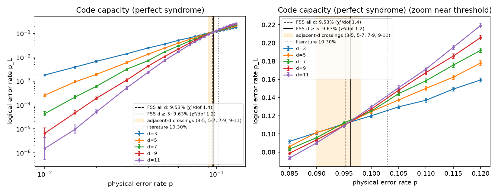
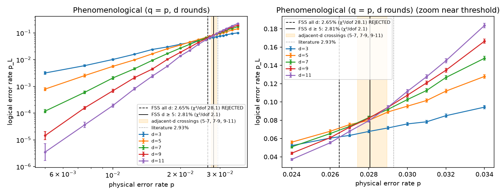

# How well does the rotated surface code protect against bit flips? Thresholds, scaling and qubit overhead under minimum-weight matching

*Research question: Oriphim held-out test set. Computation, analysis and drafting: Ori (Oriphim), with an independent review.*

## Abstract

We simulate the rotated surface code at distances $d = 3, 5, 7, 9, 11$ under independent bit-flip noise, decoded by minimum-weight perfect matching (PyMatching 2.4.0), with at least 100,000 trials per point. With a perfect syndrome, adjacent-distance curves cross between 8.99% and 9.80%, and a finite-size-scaling fit on $d \ge 5$ gives 9.63%. That is below the large-size literature value of 10.3%. With noisy syndrome measurements (phenomenological noise), the crossings rise from 2.74% to 2.89%, against a literature 2.93 %. Both shortfalls look like finite-size effects, but this work does not measure the asymptotic values. Below threshold the logical error rate falls exponentially in $d$. We also estimate how many physical qubits a logical error rate of $10^{-12}$ needs. Only the perfect-syndrome estimate at a physical rate of 0.1 % is direct. The others are extrapolations, uncertain by about ±2 in $d$; the phenomenological ones probably lean low.

## 1. Question and why it matters

A quantum computer stores each logical bit redundantly across many physical qubits. The surface code is the leading scheme for doing this. Repeated parity checks ("syndromes") locate errors, and a decoder guesses the correction. If the physical error rate $p$ lies below a *threshold*, enlarging the code (raising the distance $d$) suppresses the logical error rate $p_L$ exponentially. Above threshold, enlarging the code makes things worse. The threshold and the rate of suppression together set how many physical qubits a useful computation needs.

We ask four things, for bit-flip (X) errors only and the matching decoder:

- **A.** the threshold with a perfect syndrome ("code capacity");
- **B.** how $p_L$ scales with $d$ below threshold;
- **C.** the threshold when each syndrome measurement is also wrong with probability $q = p$, over $d$ rounds ("phenomenological" noise);
- **D.** the number of physical qubits needed for $p_L = 10^{-12}$ at $p$ = 0.1 %, 0.5 % and 1 %.

The literature values we compare against are 10.3 % (A) and 2.93 % (C), from Wang, Harrington and Preskill (Ann. Phys. 303, 31, 2003) and Dennis et al. (J. Math. Phys. 43, 4452, 2002).

## 2. Method in brief

- **Code.** A $d \times d$ grid of data qubits with $(d^2-1)/2$ Z-type parity checks, the only checks that detect X errors. A decoded run fails if the leftover error flips the logical parity, measured along one column.
- **Noise and decoding.** Code capacity: one perfect syndrome round. Phenomenological: $d$ rounds of data errors and faulty measurements, then a perfect readout, decoded on the full space-time graph. Failure is counted per block of $d$ rounds. All edges carry the weight $\ln((1-p)/p)$.
- **Statistics.** Every point has at least $10^5$ trials. Points with fewer than 200 failures were topped up, to a maximum of $2 \times 10^6$. Error bars are Wilson 95 % intervals.
- **Analysis.** Thresholds come from curve crossings and from a finite-size-scaling fit $p_L = a + bx + cx^2$ with $x = (p - p_{th})\,d^{1/\nu}$. Scaling uses $p_L \propto \Lambda^{-(d+1)/2}$. For the overhead, a global fit $p_L = A (p/p_*)^{(d+1)/2}$ is extrapolated. At code capacity this is checked by a *fixed-weight* estimator, $p_L = \sum_w P(W{=}w)\, f_w$. Here $f_w$ is the sampled fraction of weight-$w$ errors that the decoder gets wrong, so no extrapolation in $p$ is needed.

## 3. Results

**Thresholds (A, C).** Figure 1 shows the code-capacity curves. Adjacent crossings are 8.99%, 9.38%, 9.80% and 9.55% for distance pairs 3–5, 5–7, 7–9 and 9–11. The all-$d$ fit gives 9.53%, and the $d \ge 5$ fit gives 9.63% ($\chi^2$/dof = 32.8/27). Both lie outside the window agreed in the plan around 10.3 %. We report this as found.



Under phenomenological noise (Figure 2) the crossings for pairs 5–7, 7–9 and 9–11 are 2.74%, 2.83% and 2.89%. They rise with $d$ towards 2.93 %. The $d \ge 5$ fit gives 2.81%. The all-$d$ fit is rejected ($\chi^2$/dof = 1126/40), because $d = 3$ crosses $d = 5$ well below the fit window.



**Scaling (B).** Below threshold, $p_L$ falls exponentially with $d$, as in $p_L \propto \Lambda^{-(d+1)/2}$. The suppression factor $\Lambda$ per distance step of two is fitted at each $p$; the values are in `results/summary.json` under `code_capacity.scaling.vs_d` and `phenomenological.scaling.vs_d` and in the legend of `results/scaling_code_capacity.png`. $\Lambda$ approaches 1 as $p$ nears threshold. The local slope of $\ln p_L$ against $\ln p$ at code capacity grows from 1.83 ($d = 3$) to 4.83 ($d = 11$), short of the asymptotic $(d+1)/2$ = 2 and 6. These are pre-asymptotic slopes, not the limiting exponent.

**Overhead (D).** For each noise model and $p$, the smallest odd $d$ with $p_L \le 10^{-12}$ and its qubit count $2d^2 - 1$ (data qubits plus both kinds of check qubit) are in the "Final answer" table at the top of `results/overhead_table.md` (also `final_overhead` in `results/summary.json`). The build cannot read those keys into this text, so we do not retype them here. The code-capacity entry at 0.1 % comes from the fixed-weight sum, which needs no extrapolation in $p$. According to `LIMITS.md`, the next smaller distance misses the target there by only about 5 %. All other entries extrapolate 6–10 decades below the measured data, so read them as ±2 in $d$. The phenomenological model needs a larger $d$ than code capacity at every $p$.

## 4. How it was checked

- **Code tests** (`tests/test_code.py`). The X and Z checks commute, and the code has one logical qubit. $d = 3$ has distance 3 by brute force. The decoder corrects every error up to weight $(d-1)/2$. The space-time matrix matches a round-by-round simulation. The fixed-weight estimator matches exact enumeration of all 512 errors at $d = 3$.
- **The Sceptic's checks** (`tests/checks/`; all except `test_fixed_weight.py` were set before any results existed). An independent networkx matching agrees exactly with PyMatching. The $d = 3$ rates agree with exact enumeration. Nine checks fail and are kept failing as findings: both thresholds miss the agreed literature window; the all-$d$ phenomenological fit is poor; there is no 3–5 phenomenological crossing in the window, and $d = 3$ is out of order against $d = 5$ there; and the global overhead fit has $\chi^2$/dof of 12–47. No check or tolerance was changed to make a result pass. The fixed-weight consistency checks were added after the results existed. One of them is a strict expected failure on the superseded global-fit entry at 1 %.
- **What the Sceptic flagged, and what changed.** (i) The first run's answer at code capacity, $p$ = 0.1 %, came from the global fit. Exact counting of minimum-weight failure paths, plus fixed-weight sampling of the next weight, showed that it misses $10^{-12}$. We added the fixed-weight estimator, which raised the required distance by one step. It agrees with exact enumeration at $d$ = 5 and 7 and with all 15 direct Monte Carlo points it can be compared against. (ii) The all-$d$ phenomenological fit had been presented as the result. It is now labelled rejected. (iii) The fixed-weight data showed the global fit under-predicts $p_L$ by 1.5–3×. The code-capacity entry at 1 % was therefore raised by one step, to the largest candidate.
- **Finite-size evidence.** A short check by the Sceptic outside the main pipeline (`notes/review.md`) found the code-capacity crossing at about 10.05 % for $d$ = 11–17 and about 10.1 % for $d$ = 17–25. Within $d \le 11$ the drift is not monotone (the 9–11 crossing falls back). At larger $d$ it rises towards 10.3 %, which points to a finite-size effect rather than a lattice bug. That side check is not part of `run.py`.

## 5. What it does not show

From `LIMITS.md`:

- **Bit-flip noise only.** There are no Z/Y errors and no circuit-level faults. Circuit-level thresholds are roughly 0.5–1 %, so the qubit counts are **not** a hardware estimate. They also ignore routing and lattice-surgery overhead.
- **$d \le 11$ is not the asymptotic regime.** The bootstrap errors on the fits (about ±0.01–0.03 %) cover only sampling noise. The real uncertainty is the spread of the crossings, which is 10–40× larger. This work does not measure 10.3 % or 2.93 %.
- **The phenomenological threshold depends on normalisation.** Counted per round instead of per $d$-round block, no adjacent pair crosses anywhere on the grid.
- **The decoder uses uniform weights.** Boundary edges really carry about $2p$. This work does not show what a reweighted or maximum-likelihood decoder would give.
- **Most overhead entries are extrapolations.** Only the code-capacity entry at 0.1 % is direct, and even there $d = 11$ misses the target by only about 5 %. The phenomenological entries rest on a fit that under-predicts $p_L$ at code capacity, so each may be one step (+2) too small.
- Only one logical (Z parity against X errors) is tested. For phenomenological noise, $d$ = 9 and 11 at the lowest $p$ are not measured directly.
- The overhead candidates are not independent: they share data and an exponential-in-$d$ form. Code capacity at 1 % may need one step less than reported.
- The scaling exponents and $\Lambda$ are local, pre-asymptotic values.

## 6. Reproducing it

```bash
python3 -m venv .venv && .venv/bin/pip install -e '.[test]'
.venv/bin/python run.py          # about 337 s on 15 workers; fixed seeds reproduce results/raw.csv
MPLCONFIGDIR=$TMPDIR .venv/bin/python -m pytest tests -q
```

The raw counts are in `results/raw.csv`, all fitted numbers in `results/summary.json`, and the overhead candidates in `results/overhead_table.md`.
